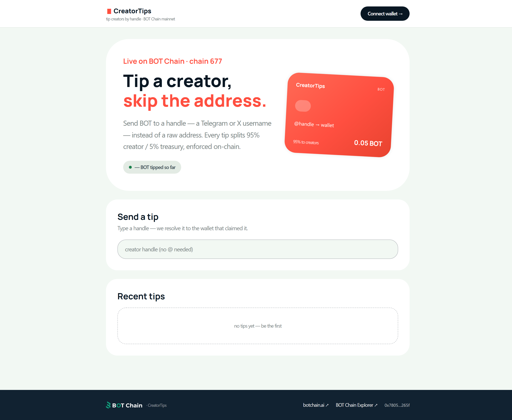
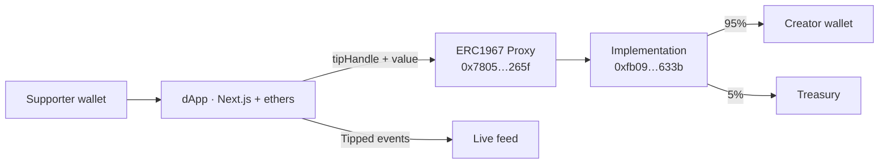

# CreatorTips — tip a creator, skip the address

Send BOT to a **handle** — a Telegram or X-style username — instead of a raw
wallet address. Every tip splits **95% creator / 5% treasury**, enforced
on-chain. Live on BOT Chain mainnet (chain 677).

**Contract (proxy):** [`0x7805af581EE18e449bd0d4F5b99b9DC1b8a0265f`](https://scan.botchain.ai/address/0x7805af581EE18e449bd0d4F5b99b9DC1b8a0265f) · UUPS-upgradeable (ERC1967)



## The problem

Tipping a creator on-chain means asking them for a 42-character address —
and sending money to a typo. A claimed human handle resolves to the wallet
on-chain, so supporters type `@name` and the contract does the rest.

## What it does

- **Claim a handle** — one lowercase `a-z0-9._-` handle (2–32 chars) per wallet,
  enforced on-chain
- **Tip by handle** — `tipHandle` payable; reverts below the 0.001 BOT minimum;
  the 95/5 split is contract-enforced, not app-enforced
- **Live feed** — the dApp reads `Tipped` events straight from chain — no
  indexer, no database
- **Resolve handles publicly** — anyone can check what a handle maps to
  before tipping

## Architecture



Writes (`setHandle`, `tipHandle`) are signed transactions; reads
(`resolveHandle`, `handleOf`, `totalTipped`) are free calls. Upgrade authority
sits with the owner wallet only — the proxy address never changes.

## Built with

| Layer | Choice | Why |
|---|---|---|
| Contract | Solidity, UUPS + ERC1967, `ReentrancyGuard` on the payable path | permanent address + safe payouts |
| App | Next.js App Router + TypeScript + Tailwind v4 | zero-config deploy |
| Chain | ethers v6, EIP-6963 wallet discovery | multi-wallet support |
| Design | Monzo design system via [styles.refero.design](https://styles.refero.design/style/e8a1d114-6924-4f03-acd2-996dd30f15a6) | adaptation — see `DESIGN.md` |

## Real vs. mocked

Everything is real: handle claims, tips, the split, and the feed are all
on-chain reads/writes against the mainnet contract. Nothing is simulated.
The feed caps at the latest 30 `Tipped` events for performance.

## Local setup

```bash
cd app
npm install
npm run dev   # http://localhost:3000 — no env vars needed
```

Deploying a fresh contract (optional):

```bash
npm install
cp .env.example .env           # DEPLOYER_KEY + OWNER_ADDRESS + TREASURY_ADDRESS
npm run deploy                 # writes deployed.json; point app at the new proxy
```

## Known limitations

- One handle per wallet; handles can't be transferred or released
- The feed scans recent blocks on load — very old tips don't appear without an indexer
- Handles are claimed on a first-come basis; no dispute process exists
- A BOT Chain RPC outage interrupts reads and writes (wallet flows fail with a toast)

## License

- This project: MIT — see [LICENSE](LICENSE)
- OpenZeppelin contracts (`contracts/lib/`): MIT
- Fonts (Inter, Manrope, JetBrains Mono via `next/font`): OFL
- Visual system adapted from Monzo's public design language (see `DESIGN.md`)
- BOT Chain wordmark from the official BOT Chain brand kit
